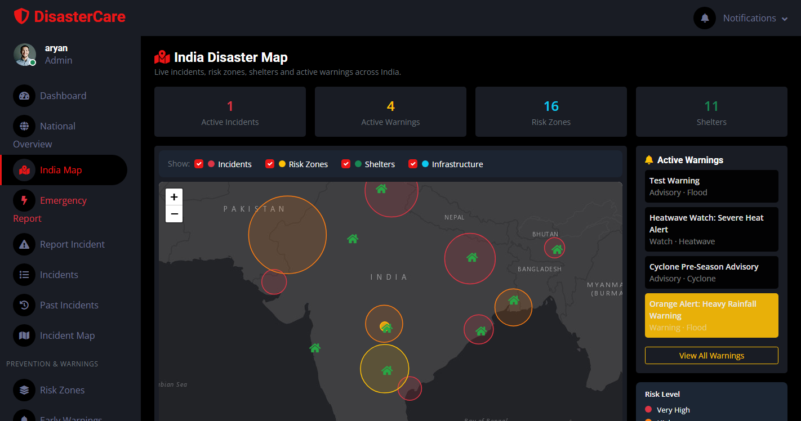
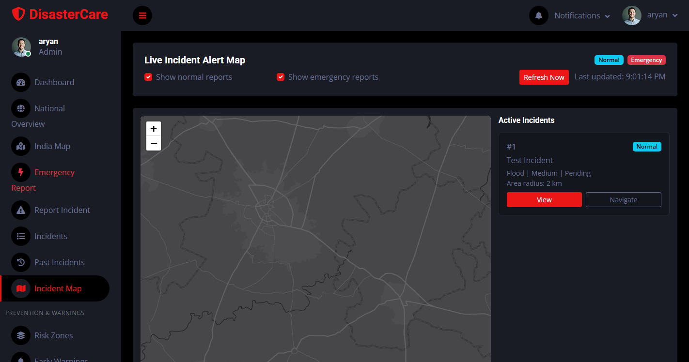
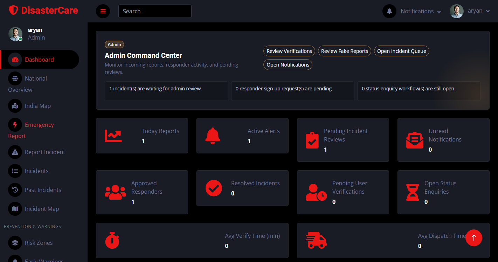
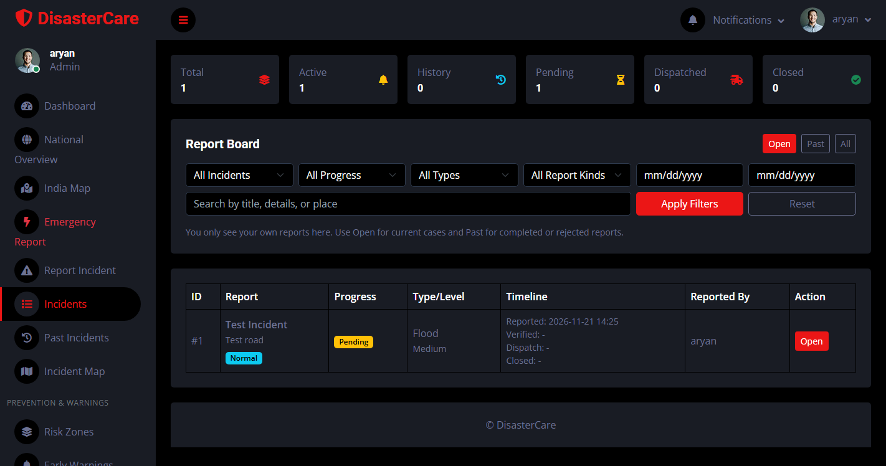
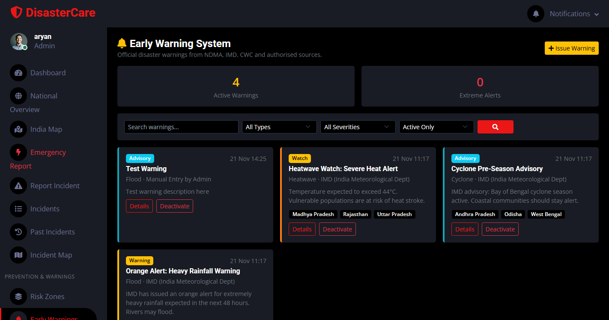
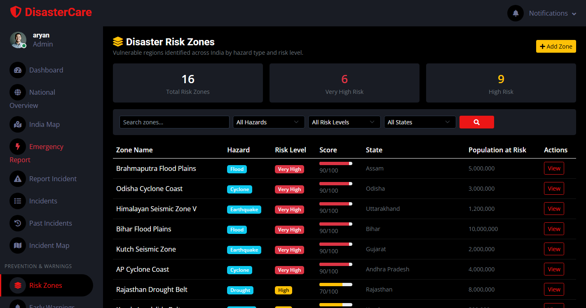
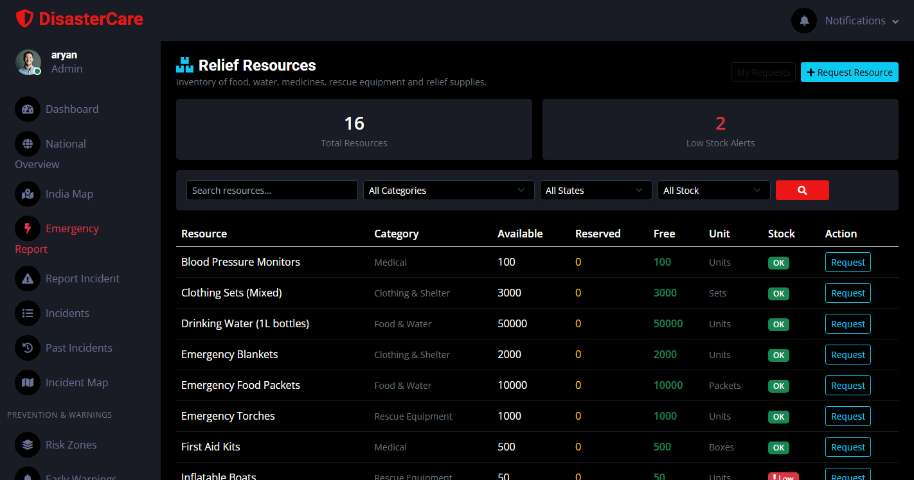
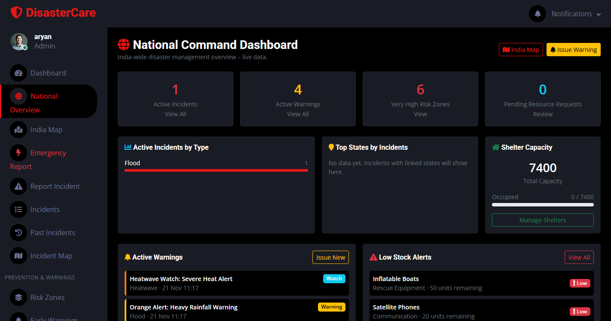
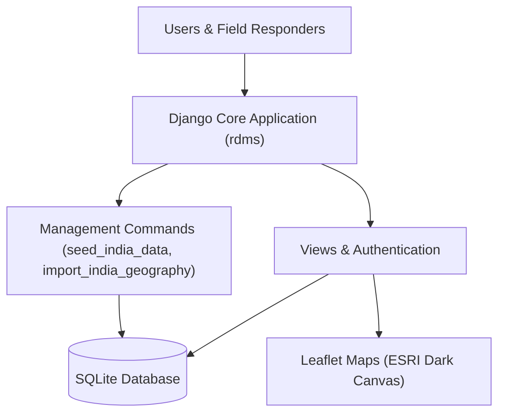

# DisasterCare

**India-Based Disaster Management and Emergency Response Coordination System**

DisasterCare is a full-stack Django platform for disaster prevention, early warning, incident response, evacuation coordination, relief management and post-disaster recovery across all Indian states and union territories.

---

## 📸 Screenshots

| India Disaster Map | Live Incident Alert Map |
|:---:|:---:|
|  |  |

| Dashboard Overview | Active Incidents List |
|:---:|:---:|
|  |  |

| Emergency Incident Report | Early Warnings |
|:---:|:---:|
|  |  |

| Disaster Risk Zones | Emergency Shelters |
|:---:|:---:|
|  |  |

| Relief Resources | Critical Infrastructure Registry |
|:---:|:---:|
|  |  |

| National Operations Overview | Responder Rankings |
|:---:|:---:|
|  |  |

---

## Features

### India-Wide Geographic Coverage
- All 36 states/UTs with **790 districts** (complete LGD-based data)
- Interactive India map (Leaflet.js) with incidents, risk zones, shelters and infrastructure layers
- Role-filtered map data: reporters never receive incident coordinates
- AJAX district cascade by state across all forms

### Disaster Risk Assessment & Prevention
- 15 pre-seeded risk zones covering flood, cyclone, earthquake, drought, landslide, heatwave, forest fire and tsunami
- Risk scoring 0–100 with Low / Moderate / High / Very High classification
- Mitigation tasks with priority, deadline, assignment, progress tracking and status workflow
- District-level prevention overview

### Early Warning System
- Issue and manage official warnings with severity: Advisory / Watch / Warning / Extreme Alert
- Sources: NDMA SACHET, IMD, CWC, INCOIS or manual admin entry
- State and district targeting with affected-area mapping
- Duplicate detection, expiry and deactivation
- `sync_warnings` management command with IMD and NDMA adapter stubs (live feed activated by setting `IMD_FEED_URL` / `NDMA_FEED_URL` env vars)
- All imported warnings labelled `is_verified=False` pending admin review

### Location-Based Notification Subscriptions
- Users subscribe to states or districts for targeted alerts
- In-app and email notification preferences per subscription
- Duplicate prevention with `get_or_create`
- Full subscription management page

### Incident Reporting & Rescue Coordination
- Normal and emergency (fast-track verified) incident reporting
- Complete lifecycle: Report → Verify → Dispatch → On Scene → Stabilize → Escalate → Close
- Responder assignment, acceptance, declination and redispatch
- Fake-report submission and admin moderation
- Keyword-based triage (severity, incident type, risk score)
- Photo and media attachments (up to 6 per incident)
- Status enquiry workflow with overdue action

### Evacuation & Shelter Management
- 10 pre-seeded emergency shelters across India
- Real-time capacity, occupancy and facility tracking (food, water, electricity, sanitation, medical, wheelchair access)
- Evacuation plan creation, shelter assignment and one-click activation
- Linked to incidents for post-event coordination

### Relief Resource Management
- 16 pre-seeded resources across 5 categories with stock levels
- Full request → approve → dispatch → deliver lifecycle
- Atomic reservation prevents double-allocation
- Low-stock alerts on list and national dashboard

### Critical Infrastructure Registry
- Register hospitals, schools, bridges, dams, fire stations, water facilities, power plants
- Sensitive assets restricted to admin-only view
- Geographic filtering by state/district/category
- Interactive map view and layer toggle

### Post-Disaster Damage Assessment
- Link damage reports to incidents
- Record homes damaged/destroyed, roads, crops, public infrastructure, estimated losses
- Admin verify / reject workflow
- District and incident-level aggregation

### Role-Based Dashboards
- **National Admin**: India-wide map, incident type breakdown, state counts, active warnings, low-stock alerts, all quick actions
- **Responder**: Assignment queue, active commitments, responder rankings, map
- **Reporter**: My reports, status tracking, notifications, alert subscriptions

### Security
- `india_map_data_view` requires authentication; reporters receive only non-sensitive incident metadata (no coordinates, no addresses)
- All admin-only write actions (create warning, risk zone, shelter, verify assessment) blocked from non-admin users with no data mutation
- CSRF on all POST operations
- Role-based access on every view

---

## Architecture



---

## Quick Start

### Prerequisites
- Python 3.11+

### Setup

```bash
git clone https://github.com/Aryan012334/DisasterCare.git
cd DisasterCare

pip install -r requirements.txt

cp .env.example .env
# Edit .env — set DJANGO_EMAIL_HOST_USER and DJANGO_EMAIL_HOST_PASSWORD

python manage.py migrate
python manage.py seed_india_data        # seeds states, districts, risk zones, shelters, resources, demo warnings
python manage.py import_india_geography # loads all 790 LGD districts (idempotent)
python manage.py createsuperuser
python manage.py runserver
```

Open http://127.0.0.1:8000 and log in with your superuser account.

---

## Management Commands

| Command | Description |
|---|---|
| `seed_india_data` | Seeds 36 states/UTs, 144 districts, 15 risk zones, 10 shelters, 16 resources, 3 demo warnings |
| `import_india_geography` | Idempotent import of all 790 LGD districts (safe to re-run) |
| `sync_warnings` | Sync early warnings from IMD/NDMA (requires feed URLs in .env) |
| `sync_warnings --dry-run` | Preview what would be imported without saving |
| `sync_warnings --source imd` | Sync only the IMD adapter |

---

## Environment Variables

| Variable | Description | Default |
|---|---|---|
| `DJANGO_SECRET_KEY` | Secret key (required in production) | Dev key |
| `DJANGO_DEBUG` | Debug mode | `True` |
| `DJANGO_ALLOWED_HOSTS` | Comma-separated hosts | `127.0.0.1,localhost` |
| `DJANGO_EMAIL_BACKEND` | Email backend | `django.core.mail.backends.console.EmailBackend` |
| `DJANGO_EMAIL_HOST_USER` | SMTP email (required for OTP reset in production) | — |
| `DJANGO_EMAIL_HOST_PASSWORD` | SMTP password | — |
| `DJANGO_EMAIL_HOST` | SMTP host | `smtp.gmail.com` |
| `DJANGO_EMAIL_PORT` | SMTP port | `587` |
| `IMD_FEED_URL` | JSON feed URL for IMD live warnings sync | — |
| `NDMA_FEED_URL` | JSON feed URL for NDMA SACHET live sync | — |

See `.env.example` for full list.

---

## Running Tests

```bash
python manage.py test
```

**107 tests, all passing.**

---

## Tech Stack

- **Backend**: Django, SQLite
- **Frontend**: Bootstrap 5, Leaflet.js, Font Awesome
- **Maps**: Leaflet.js with ESRI Dark Canvas tiles
- **Auth**: Email/Username-based login, OTP password reset
