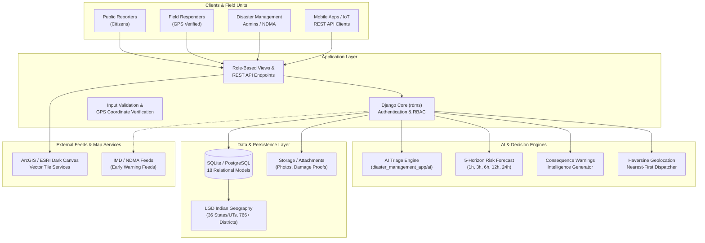
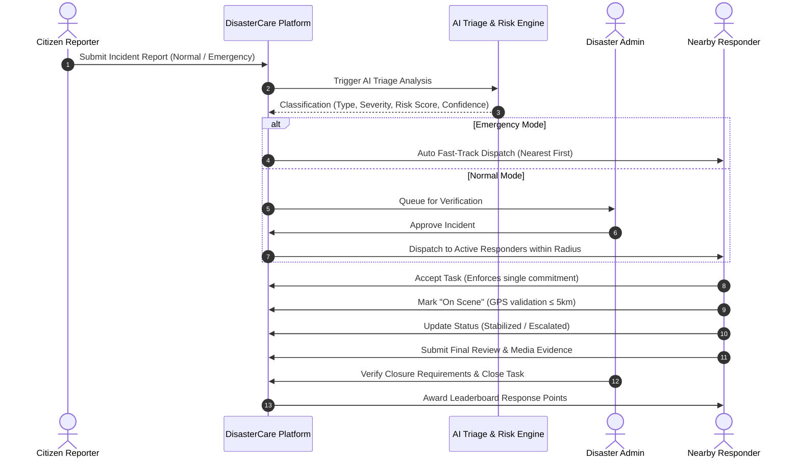
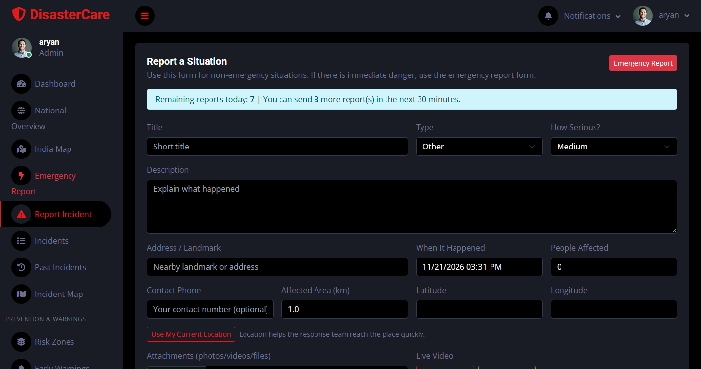
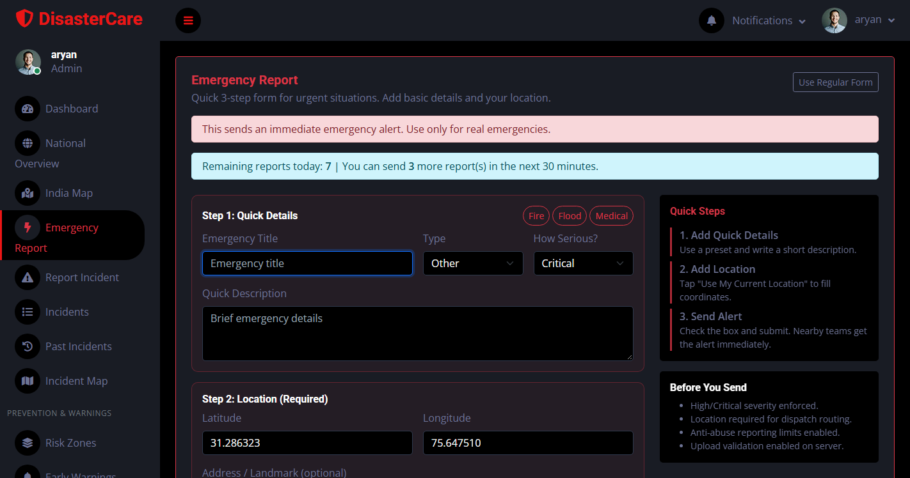
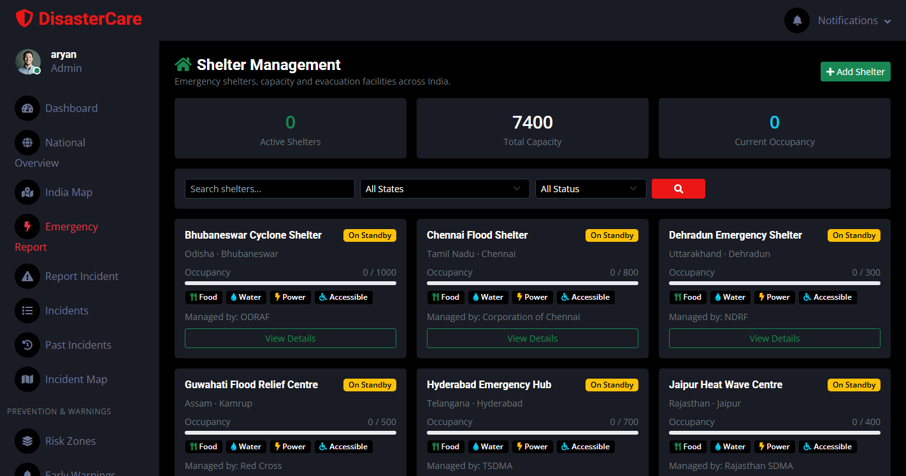
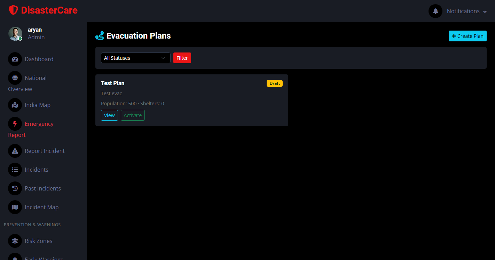
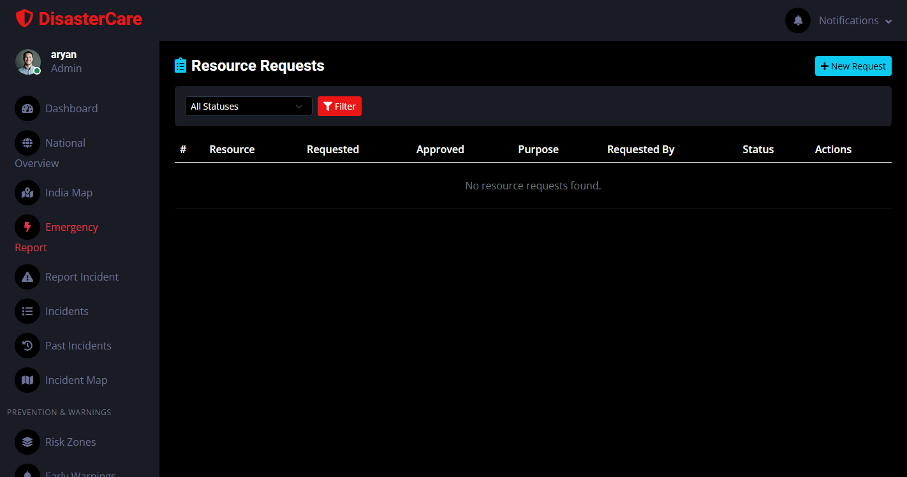
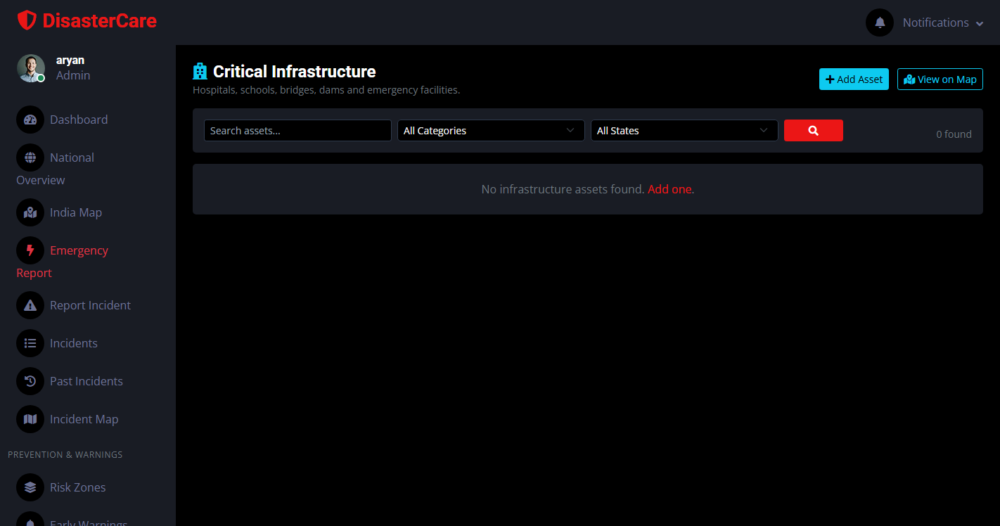
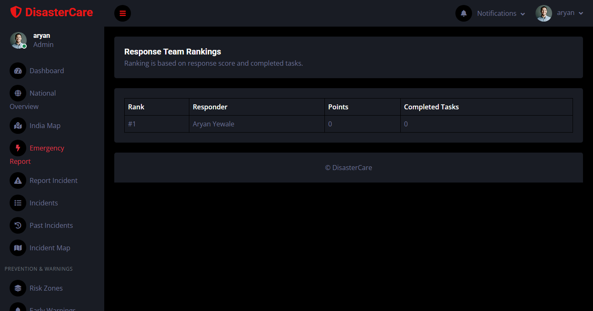
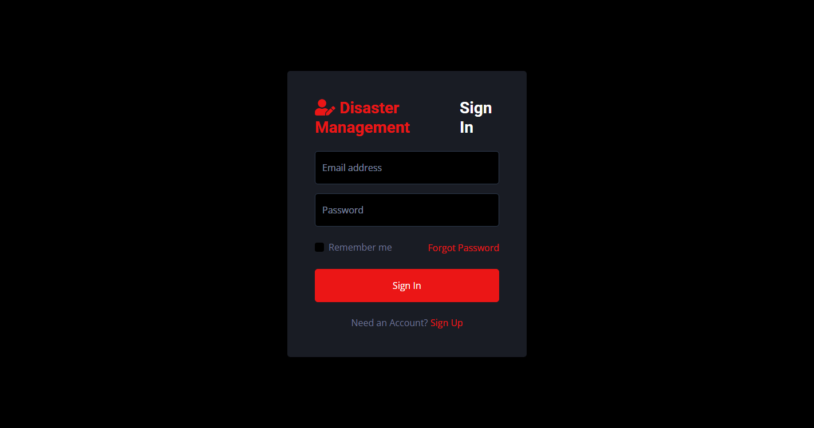

# DisasterCare 🛡️

**Community-Based Rapid Disaster Management & Emergency Response Coordination Platform**

[](https://www.djangoproject.com/)
[](https://www.python.org/)
[](https://getbootstrap.com/)
[](https://leafletjs.com/)
[](https://github.com/Aryan012334/DisasterCare)
[](LICENSE)

DisasterCare is an India-wide, enterprise-grade emergency management and disaster response system built on Django. It connects citizens, first responders, and government administrators into a coordinated real-time network for disaster reporting, AI triage, automated dispatch, shelter coordination, relief logistics, and early warnings.

---

## 📑 Table of Contents

- [System Architecture](#-system-architecture)
- [Incident Response Lifecycle](#-incident-response-lifecycle)
- [Visual Walkthrough & Screenshots](#-visual-walkthrough--screenshots)
  - [1. National Operations & Dashboard](#1-national-operations--dashboard)
  - [2. Interactive Disaster Maps](#2-interactive-disaster-maps)
  - [3. Incident Reporting & Verification](#3-incident-reporting--verification)
  - [4. Early Warnings & Risk Zones](#4-early-warnings--risk-zones)
  - [5. Evacuation & Shelters](#5-evacuation--shelters)
  - [6. Relief Logistics & Critical Infrastructure](#6-relief-logistics--critical-infrastructure)
  - [7. Responder Dispatch & Leaderboard](#7-responder-dispatch--leaderboard)
- [Core Features](#-core-features)
- [Tech Stack](#-tech-stack)
- [Getting Started](#-getting-started)
- [REST API Reference](#-rest-api-reference)
- [Management Commands](#-management-commands)
- [Testing & Quality Assurance](#-testing--quality-assurance)

---

## 🏛️ System Architecture



---

## 🔄 Incident Response Lifecycle



---

## 📸 Visual Walkthrough & Screenshots

All screenshots are captured directly from the live application running on local port `8000`.

### 1. National Operations & Dashboard

The command center providing national statistics, role-based controls, active warning indicators, and quick action gates.

| Main Operational Dashboard | National Disaster Overview |
|:---:|:---:|
|  |  |

---

### 2. Interactive Disaster Maps

Powered by high-contrast **ArcGIS / ESRI Dark Gray Canvas tiles** with zero API keys required. Features active incident circles, evacuation shelter pins, multi-hazard risk zones, and critical infrastructure overlays.

| India-Wide Multi-Layer Disaster Map | Live Incident Alert Map |
|:---:|:---:|
|  |  |

---

### 3. Incident Reporting & Verification

Citizens can report incidents in **Normal** or **Emergency** fast-track mode with location targeting and photographic evidence attachments.

| Normal Incident Submission | Fast-Track Emergency Report |
|:---:|:---:|
|  |  |

| Active Incidents Tracking List |
|:---:|
|  |

---

### 4. Early Warnings & Risk Zones

Official weather and geological warning syndication paired with high-risk geographical zones and mitigation task tracking.

| Early Warnings Syndicate | Multi-Hazard Disaster Risk Zones |
|:---:|:---:|
|  |  |

---

### 5. Evacuation & Shelters

Real-time occupancy management for emergency shelters equipped with essential supplies and evacuation plans.

| Emergency Shelters Directory | Evacuation Plans Coordination |
|:---:|:---:|
|  |  |

---

### 6. Relief Logistics & Critical Infrastructure

End-to-end supply chain for emergency resources with atomic allocation preventing double-booking, plus hospitals, bridges, and emergency facilities map.

| Relief Resources Inventory | Resource Requests Dispatch Queue |
|:---:|:---:|
|  |  |

| Critical Infrastructure Registry with Integrated Map |
|:---:|
|  |

---

### 7. Responder Dispatch & Leaderboard

Points-based gamification rewarding responders for verified field operations and swift task stabilization.

| Responder Leaderboard & Rankings | Authentication & Secure Access |
|:---:|:---:|
|  |  |

---

## ⚡ Core Features

- **Multi-Hazard Coverage**: Pre-configured for Floods, Cyclones, Earthquakes, Landslides, Heatwaves, Forest Fires, Tsunamis, Chemical Spills, Road Collisions, and Medical Emergencies.
- **NLP & Heuristic AI Triage**: Real-time natural language classification analyzing incident reports, calculating calibrated confidence scores, and adjusting severity.
- **5-Horizon Predictive Risk Timeline**: Calculates dynamic risk probabilities at +1h, +3h, +6h, +12h, and +24h windows based on local incident density and history.
- **GPS-Fenced Responder Dispatch**: Nearby responder radius filtering using Haversine calculation, requiring on-scene GPS coordinate validation within 5.0 km.
- **Anti-Spam & Fake Incident Queue**: First responders can report false alerts; dedicated admin verification queue handles fake reports and updates reporter confidence metrics.
- **Indian Administrative Geography**: Complete Local Government Directory (LGD) database including all 28 states, 8 union territories, and 766+ districts.

---

## 🛠️ Tech Stack

- **Backend**: Python 3.11+, Django 6.0.2
- **Database**: SQLite (default for development) / PostgreSQL (production ready)
- **Frontend**: Bootstrap 5 (Dark Theme), FontAwesome 5, jQuery
- **Maps**: Leaflet.js 1.9.4 with ArcGIS / ESRI World Dark Gray Base tiles
- **Charts**: Chart.js 2.9
- **Automation**: Selenium, Webdriver Manager (automated verification & screenshots)

---

## 🚀 Getting Started

### Prerequisites

- Python 3.11 or higher
- Git

### Installation

1. **Clone the repository:**
   ```bash
   git clone https://github.com/Aryan012334/DisasterCare.git
   cd DisasterCare
   ```

2. **Create and activate a virtual environment:**
   ```bash
   python -m venv venv
   # Windows:
   venv\Scripts\activate
   # Linux/macOS:
   source venv/bin/activate
   ```

3. **Install dependencies:**
   ```bash
   pip install -r requirements.txt
   ```

4. **Configure environment variables:**
   Create a `.env` file in the project root:
   ```env
   DJANGO_SECRET_KEY=your-secure-secret-key
   DJANGO_DEBUG=True
   DJANGO_ALLOWED_HOSTS=127.0.0.1,localhost
   DJANGO_EMAIL_BACKEND=django.core.mail.backends.console.EmailBackend
   ```

5. **Run migrations and seed India geography & demo data:**
   ```bash
   python manage.py migrate
   python manage.py import_india_geography
   python manage.py seed_india_data
   ```

6. **Create an administrator account:**
   ```bash
   python manage.py createsuperuser
   ```

7. **Start the local development server:**
   ```bash
   python manage.py runserver 8000
   ```

Navigate to `http://127.0.0.1:8000/` and sign in with your credentials.

---

## 🔌 REST API Reference

### 1. Report Incident Endpoint
`POST /api/incidents/report/`

Requires user authentication session or token.

**Request Payload:**
```json
{
  "title": "Severe Flash Flood near River Bridge",
  "description": "Water level overflowed main highway. Multiple vehicles stranded and water entering buildings.",
  "incident_type": "flood",
  "latitude": 19.0760,
  "longitude": 72.8777,
  "people_affected": 45,
  "report_mode": "emergency"
}
```

**Response (201 Created):**
```json
{
  "success": true,
  "message": "Incident reported successfully.",
  "incident_id": 142,
  "incident_type": "flood",
  "severity": "critical",
  "ai_confidence": 0.94,
  "ai_risk_score": 88.0,
  "is_duplicate_suspected": false
}
```

### 2. Responder Availability Endpoint
`POST /api/responders/availability/`

**Request Payload:**
```json
{
  "is_available": "true",
  "latitude": 19.0820,
  "longitude": 72.8810
}
```

---

## ⚙️ Management Commands

| Command | Description |
|---|---|
| `python manage.py import_india_geography` | Loads all 766+ official Indian districts organized across 36 states/UTs (idempotent). |
| `python manage.py seed_india_data` | Seeds sample shelters, active risk zones, early warnings, and relief stocks. |
| `python manage.py sync_warnings` | Synchronizes active weather and disaster bulletins from official feeds. |
| `python manage.py check` | Runs comprehensive system health verification across all models and configurations. |

---

## 🧪 Testing & Quality Assurance

DisasterCare comes with an extensive automated test suite covering unit models, API endpoints, role permissions, responder dispatch, and workflow gates.

```bash
python manage.py test
```

**Results:**
```
Creating test database for alias 'default'...
...........................................................................................................
----------------------------------------------------------------------
Ran 107 tests in 117.852s

OK
Destroying test database for alias 'default'...
Found 107 test(s).
System check identified no issues (0 silenced).
```

---

## 📄 License

Distributed under the MIT License. See `LICENSE` for more information.

---

**DisasterCare** — Empowering Communities. Accelerating Response. Saving Lives.
